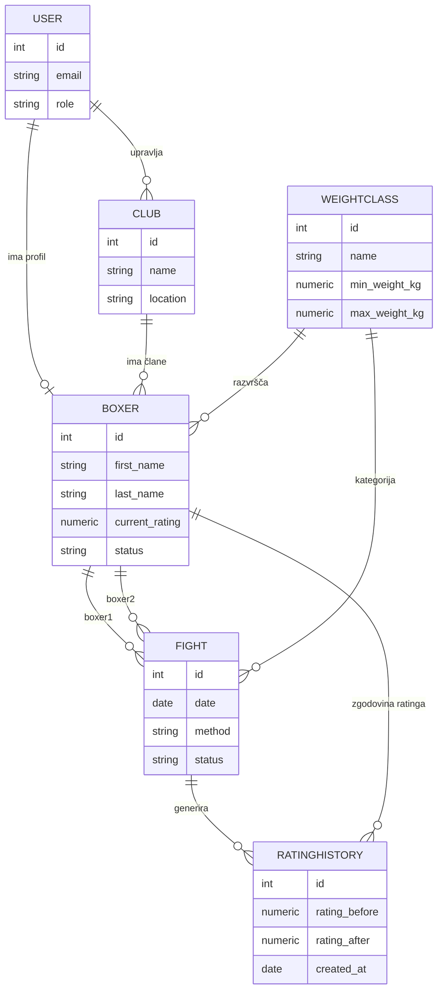

# 03 – Podatkovni model

Podatkovna baza je relacijska (PostgreSQL), zato je model prikazan kot entitetno-
relacijski (ER) diagram z glavnimi polji in tujimi ključi.

## Glavne entitete in njihova polja

### User
- `id` (PK)
- `email` (unique)
- `password_hash`
- `role` (enum: `admin`, `promoter`, `boxer`)
- `created_at`

### Club
- `id` (PK)
- `name`
- `location`
- `promoter_user_id` (FK → User.id) – uporabnik, ki upravlja klub

### Boxer
- `id` (PK)
- `user_id` (FK → User.id, nullable) – povezava z uporabniškim računom boksarja, če ga ima
- `club_id` (FK → Club.id)
- `weight_class_id` (FK → WeightClass.id)
- `first_name`, `last_name`
- `date_of_birth`
- `current_rating` (numeric, privzeto npr. 1000)
- `status` (enum: `active`, `suspended`)
- `photo_url` (nullable)

### WeightClass
- `id` (PK)
- `name` (npr. "Welter", "Super Welter")
- `min_weight_kg`, `max_weight_kg`

### Fight
- `id` (PK)
- `boxer1_id` (FK → Boxer.id)
- `boxer2_id` (FK → Boxer.id)
- `weight_class_id` (FK → WeightClass.id)
- `event_name`
- `date`
- `method` (enum: `KO`, `TKO`, `decision`, `draw`)
- `winner_id` (FK → Boxer.id, nullable pri neodločenem izidu)
- `status` (enum: `pending`, `confirmed`, `rejected`)
- `submitted_by_user_id` (FK → User.id) – promotor, ki je vnesel rezultat
- `confirmed_by_user_id` (FK → User.id, nullable) – admin, ki je potrdil

### RatingHistory
- `id` (PK)
- `boxer_id` (FK → Boxer.id)
- `fight_id` (FK → Fight.id)
- `rating_before`
- `rating_after`
- `created_at`

## Povezave med entitetami

- **User 1—1 Boxer** (opcijsko): uporabnik z vlogo `boxer` ima lahko povezan natanko
  en boksarski profil.
- **User 1—N Club**: uporabnik z vlogo `promoter` lahko upravlja enega ali več klubov.
- **Club 1—N Boxer**: en klub ima lahko več boksarjev, boksar pripada enemu klubu.
- **WeightClass 1—N Boxer**: vsak boksar je uvrščen v eno kategorijo teže.
- **Boxer 1—N Fight** (dvakrat, kot `boxer1` in `boxer2`): boksar nastopa v več dvobojih.
- **Fight 1—N RatingHistory**: ob potrditvi vsakega dvoboja nastaneta dva zapisa v
  zgodovini ratinga (eden za vsakega udeleženega boksarja).
- **Boxer 1—N RatingHistory**: boksar ima zgodovino sprememb ratinga skozi čas.

## Osnutek podatkovnega modela (Mermaid ER diagram)

