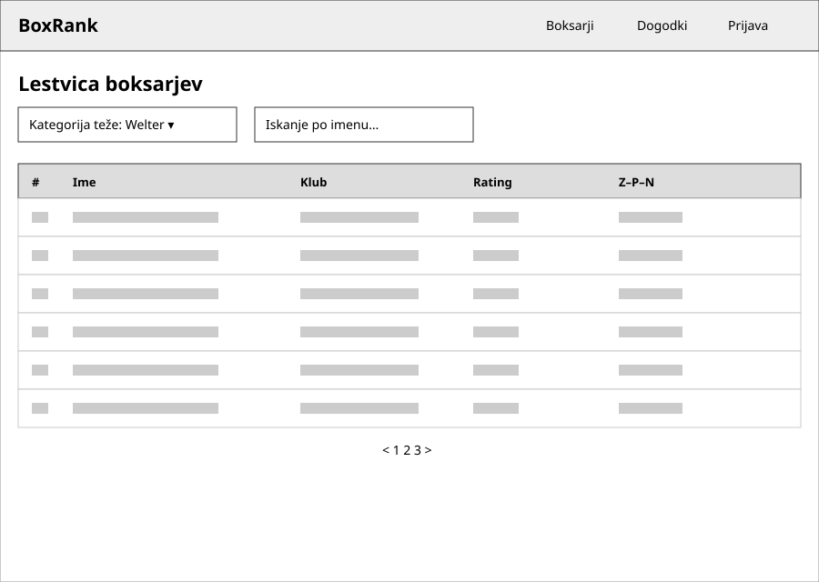
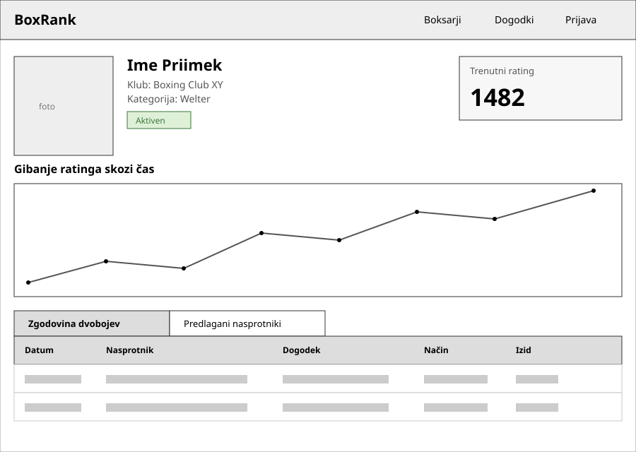
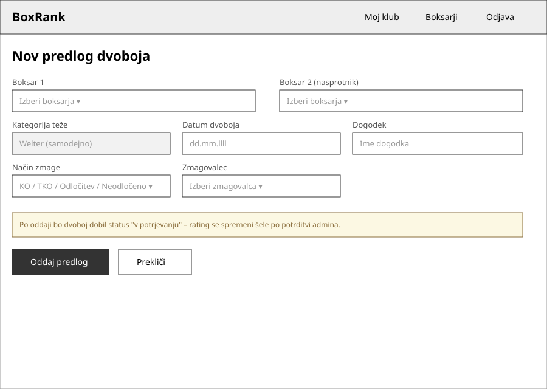

# 06 – Wireframes

Spodaj so tri osnovne skice (wireframe) ključnih zaslonov rešitve **BoxRank**,
ki pokrivajo glavni MVP tok: pregled lestvice, profil boksarja in vnos predloga
dvoboja.

## 1. Lestvica boksarjev

Javno dostopna stran brez prijave. Uporabnik izbere kategorijo teže in/ali vnese
iskalni niz, spodaj pa se prikaže razvrščena tabela boksarjev (uvrstitev, ime,
klub, rating, razmerje zmag–porazov–neodločenih) s straničenjem na dnu.

## 2. Profil boksarja

Prikazuje osnovne podatke boksarja (fotografija, klub, kategorija teže, status),
trenutni rating in graf gibanja ratinga skozi čas. Spodaj sta zavihka za zgodovino
odigranih dvobojev in predlagane primerne nasprotnike.

## 3. Vnos predloga dvoboja (promotor)

Obrazec, ki ga uporablja promotor za vnos rezultata odigranega dvoboja (oba
boksarja, kategorija teže, datum, dogodek, način zmage, zmagovalec). Opozorilo
pojasni, da dvoboj po oddaji dobi status "v potrjevanju" in ne vpliva na rating,
dokler ga admin ne potrdi.
